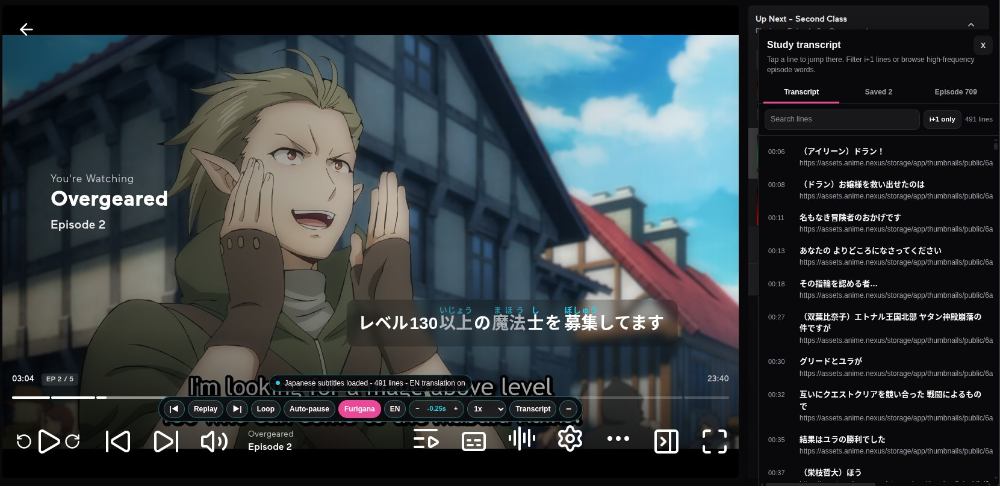
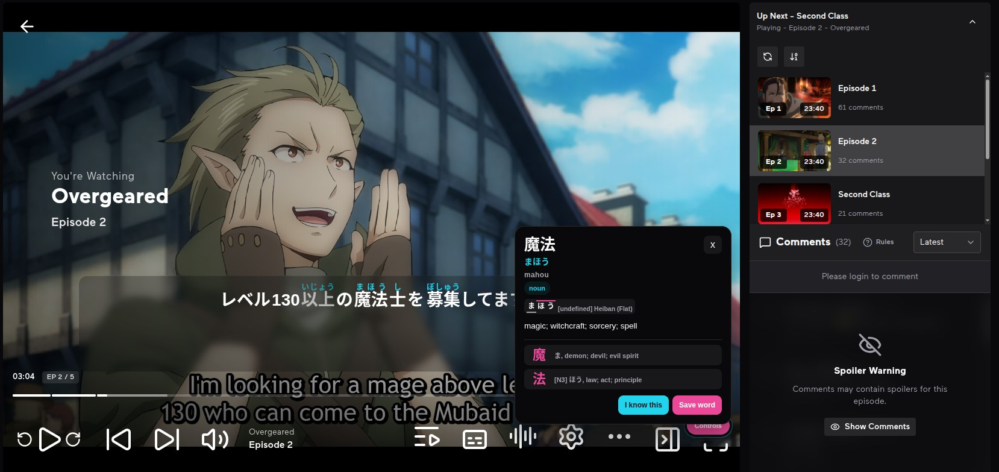
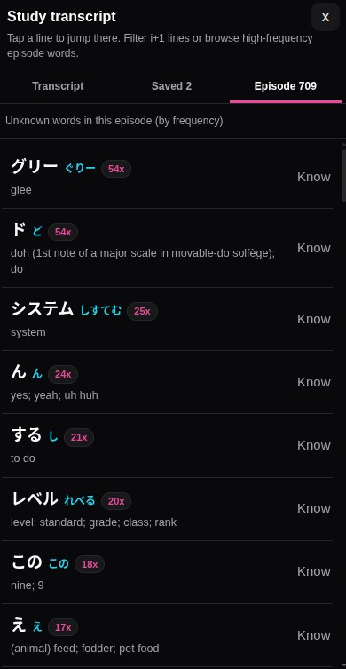
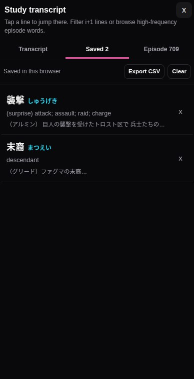
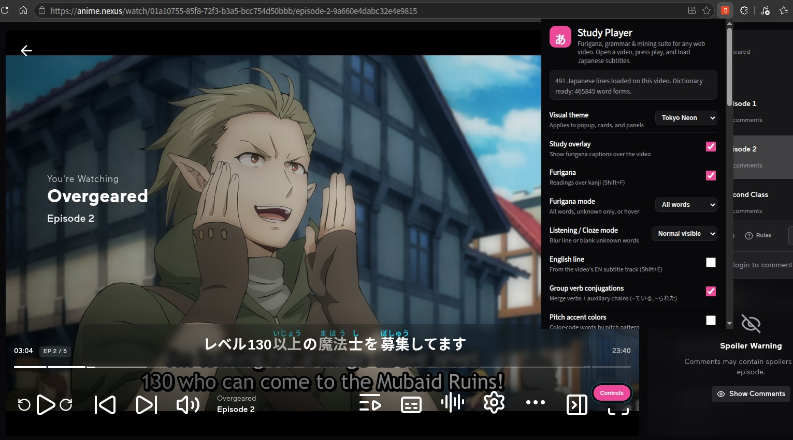

# Study Player Anywhere

**Learn Japanese from the stuff you actually watch.** This browser extension turns Japanese subtitles on **almost any web video player** into an interactive study layer: furigana over every line, tap any word for its reading, meaning, romaji, and pitch accent, replay and loop lines, slow down for shadowing, search the full transcript, save words to a list you can export, and mine sentences into Anki flashcards with one click.

Everything runs locally in your browser, fully offline after the first load. No account, no analytics, no phoning home, no subscription. Free and open source (MIT), forever.

**Why this exists:** good Japanese learning tools keep ending up behind weekly or monthly paywalls. This one is built in the open instead, with a little AI help, so anyone can use it, inspect it, and make it better.

## New in 2.8.0

The biggest upgrade yet:

- **6 visual themes**: Classic Light, Midnight Obsidian, Cyberpunk Neon, Sakura Washi, Matcha Zen, and OLED Pitch Black, across the popup and every on-video surface.
- **Smarter word cards**: compound verbs merge into one clickable word with conjugation tags, plus pitch accent contours and kanji radical/lookalike breakdowns.
- **Active listening modes**: blur captions until hovered, or cloze mode that hides one unknown word per line. Furigana can show for all kanji, unknown words only, or on hover.
- **Study the whole episode**: the Episode tab ranks every unknown word by frequency, and the i+1 filter shows only lines with exactly one unknown word.
- **Real show audio in your Anki cards**: record the actual line audio, plus an optional screenshot, with custom field mapping. Shadow mode scores your pronunciation mora by mora.
- **Timing tools**: nudge subtitles by 0.25s from the control bar, or auto-sync to the video's speech.
- **No subtitles? No problem**: live transcription for raw videos, or search Jimaku.cc for anime subtitle files right from the Subs menu.
- **Plus:** auto-pause per line, hover-to-pause, draggable captions, Anki known-word sync, and iframe player support.

Full details in the changelog below.

**No Japanese subtitles on the site? No problem.** Some services (Crunchyroll, for example) do not offer a Japanese subtitle track at all. Download a Japanese `.srt` for the episode (kitsunekko.net and jimaku.cc are the usual sources for anime) and load it with the **Load sub** button in the toolbar popup. The whole study layer works exactly the same.

## Screenshots

## Install (Chrome, Edge, Brave, Arc)

1. Unzip this package somewhere permanent (do not delete the folder afterward, the browser loads from it).
2. Open `chrome://extensions` (or `edge://extensions`).
3. Turn on **Developer mode** (top right).
4. Click **Load unpacked** and select the unzipped folder (the folder that contains `manifest.json`).
5. Pin **Study Player Anywhere** from the puzzle-piece menu so it is always one click away.

Firefox: open `about:debugging#/runtime/this-firefox`, click **Load Temporary Add-on**, and choose `manifest.json` inside the folder. Temporary add-ons are removed when Firefox restarts; for a permanent install you would need a signed build.

## Use it (any site)

1. Open a page with a video and **press play**. The study caption appears over the lower part of the player once Japanese lines are loaded.
2. Get Japanese subtitles in, in whichever way the site allows:
   - **Automatic (new):** when the extension spots a subtitle file on the page it loads it by itself and tells you in the status pill. You no longer have to open **Subs** and pick it, though you still can.
   - **Player captions:** if the site's own player has a CC / subtitle menu, pick Japanese there. Study Player reads the player's subtitle track directly when the browser exposes it.
   - **Streaming (HLS) captions:** if the player streams with subtitle playlists, Study Player follows the playlist to the actual subtitle segments automatically.
    - **Subs button:** in the toolbar popup, **Subs** lists subtitle files (`.vtt` / `.srt` / `.ass` / HLS playlists) the extension spotted the page loading, plus a diagnostics readout, **Auto-Sync to Voice**, **Live ASR (Transcribe)**, and **Jimaku.cc Anime Subtitle Search** (see below). Pick any discovered or searched subtitle file to load it directly.
   - **Load sub button:** pick an `.srt`, `.vtt`, or `.ass` file from your device (you can select a Japanese and an English file together). This always works, and it is the fallback for sites that hide their captions.
   - **YouTube:** open any YouTube video with a Japanese track (creator captions or auto-generated Japanese) and Study Player picks it up automatically; an English track, when present, shows under each line. If the direct caption fetch still comes back empty, turn the player's own CC on once, Study Player can then read the captions from the request the player itself makes.
3. Controls under the caption: **Replay** (or `R`), **Prev** / **Next**, **Loop**, **Auto-pause** (`P`), **Furigana** (`Shift+F`), **EN** (`Shift+E`), **Subtitle Timing Offset** (`-` / `+` or `[` / `]` / `\`), the speed menu for shadowing, and **Transcript** for the searchable line list, saved words, and episode frequency breakdown. Drag the `⋮⋮` handle on the left of the caption box to float captions anywhere on the video (double-click `⋮⋮` to reset). Tap the **−** button at the right edge to minimize the control bar; tap **Controls** to bring it back.
4. Tap any Japanese word in the big caption to see its reading, romaji, meaning, JLPT level, **conjugation chain** (e.g., `past · polite`), **visual pitch accent contour** (`heiban` / `atamadaka` / `nakadaka` / `odaka`), and **kanji component & lookalike breakdown**, then **Save word** or mark it **Known**. Saved words live under Transcript → Saved, and in the toolbar popup, and export as CSV (Word, Reading, Part of speech, Meaning, Japanese context, Translation) for Anki or a spreadsheet.
5. Pages with several players: Study Player follows the one that is playing, or the largest one. The Subs menu tells you how many players it found.

## What it cannot read (please read)

- **Burned-in subtitles** that are part of the picture are pixels, not text. Nothing can extract them; grab a separate Japanese `.srt` for that video and use **Load sub**.
- **DRM-locked players** (the big subscription services) do not hand subtitle data to extensions in a readable form. This build deliberately targets ordinary HTML5 players, which covers most other sites.
- A site in a **cross-origin iframe** player can limit what any extension can see. **Load sub** still works there whenever the video itself is reachable.
- `.ass` styling and positioning are stripped; only the dialogue text and timing are used. `.ssa` is treated the same way.
- If a site never exposes any subtitle file and has no CC menu, **Load sub** with a subtitle file you sourced yourself is the whole answer. Subtitle files are widely available separately from videos.
- **Crunchyroll:** Crunchyroll does not offer a Japanese subtitle track at all, so there is nothing for the extension to pick up automatically. Download a Japanese `.srt` for the episode (kitsunekko.net and jimaku.cc are the usual sources) and load it with the **Load sub** button in the toolbar popup. Verified working in 2.6.0.

## Good to know

- Plain Japanese text always works. Furigana is generated locally in your browser with a built-in Japanese dictionary (the `dict` folder), so the first video takes a few seconds while it loads, then it is instant for the rest of the session. It works fully offline after that.
- Word definitions come from the full JMdict, the EDRDG Japanese-English dictionary (465,845 lookup forms, common words prioritized). It loads once per page in the background; a word tapped during those first seconds fills its definition in automatically when the dictionary lands. JMdict is (C) the Electronic Dictionary Research and Development Group, used under their licence (https://www.edrdg.org/edrdg/licence.html). JLPT word levels come from the OpenJLPT project (https://github.com/evanclan/OpenJLPT), used under CC BY-SA 4.0; the JLPT has published no official vocabulary lists since 2010, so levels are a well-informed approximation.
- Native player captions are hidden while the overlay is on so you do not see double subtitles. Your player's own caption settings are not changed.
- Saved words are stored only in this browser (`chrome.storage.local`). Clearing the extension's data clears the list, so export a CSV when it matters.
- Because this build runs on any site, the browser will show a broader site-access permission than the old YouTube-only build. The extension still makes no analytics calls and sends nothing anywhere; it only reads the page's own video and subtitle data locally, plus local files inside the extension.

## Updating (do both reloads, or the old code keeps running)

Chrome and Edge do not auto-update unpacked extensions. Unzip this version over (or next to) the old folder, open `chrome://extensions` (or `edge://extensions`), find **Study Player Anywhere**, click **Reload**, then reload the video tab too. Skipping either reload leaves the old code running. Your saved words carry over. This update takes the version to 2.8.0; the version on the extension card is the quickest way to confirm you are running it.

## Known issues

- YouTube auto-captions are machine-generated run-on text. Version 2.3.2 improves long katakana boundaries, but unusual names, speech-recognition mistakes, and ambiguous grammar can still be grouped incorrectly.
- On some auto-caption videos the first line can remain frozen or plain until the furigana engine finishes or the page is reloaded. Versions 2.3.1 and 2.4.0 each fixed one timing path behind this; if you still see it, the **Copy diagnostics** button in **Subs** captures everything useful for a bug report.
- **Send to Anki** needs the free AnkiConnect add-on installed in Anki and Anki itself open. If it cannot reach Anki, the miner says so and offers CSV instead.

## Troubleshooting

- **Still no subtitles**: open **Subs** on the video. The top box is the diagnostics readout: it shows the page, how many video players and player subtitle tracks were found (with their languages and line counts), which YouTube caption tracks exist, how many subtitle files were spotted, and a short log of what was fetched and what came back. Hit **Retry detection** after pressing play and turning the player's CC on. If you send anyone a bug report, that readout is the useful part.
- **"Japanese track was empty" on YouTube**: fixed in 2.1.1. If you still see it, confirm the extension card says 2.6.0 and both reloads above were done, then try turning YouTube's own CC button on once and hitting **Retry detection** in **Subs**.
- **Furigana missing but subtitles show**: give the first video a few seconds, check the small status pill under the caption, and reload the page once. The dictionary is about 40 MB unpacked, so a slow disk can take a moment.
- **Nothing appears at all**: confirm Developer mode is still on, the extension is enabled at `chrome://extensions`, that the video has actually started, then reload the page. Some sites build their player late; Study Player keeps watching and attaches when a video shows up.
- **Overlay sits in the wrong place**: it anchors to the player's container. Going fullscreen with the player's own fullscreen button usually fixes positioning; one page reload clears anything stuck.
- **Stuck on "Study Player loading"**: fixed in 1.1.0 and carried forward. The status pill now says what is missing instead of spinning forever. Update and reload as above.

## Privacy

The extension runs on pages you visit so it can find video players, but it does not collect analytics, does not phone home, and does not send your watch history or word list anywhere. The only network requests it makes are the subtitle-file requests for the video you are already watching (plus optional `jimaku.cc` queries if you configure a Jimaku API key and press **Search Jimaku**), and local files inside the extension. The sentence miner's **Send to Anki** and **Sync from Anki** talk to AnkiConnect on your own machine (`http://127.0.0.1:8765`) only when you press those buttons; the **Listen** button uses your browser's built-in voices with no network involved. **Live ASR (Transcribe)** is the one exception: it uses your browser's built-in speech recognition, which sends the audio to the browser vendor's speech service.

## Files

- `manifest.json` - extension definition (Manifest V3, all-sites, version 2.8.0)
- `content.js` / `content.css` - the overlay, transcript, episode vocabulary analyzer, dictionary UI, subtitle parsers (VTT/SRT/ASS, YouTube XML and json3, HLS playlists), native-track reader, auto-loader, diagnostics, audio auto-sync, live ASR, sentence miner (with show audio recording and shadowing pronunciation scorer), and local file loader
- `lib/token-refiner.js` - compound verb/adjective coalescer (`食べていませんでした` → single token with conjugation tags), colloquials & contractions expander (`ちゃう`, `なきゃ`, `っす`, etc.), pitch accent mora contour analyzer, kanji radical/lookalike inspector, and shadowing pronunciation scorer
- `injected.js` - page-world helper installed before the player boots: reads YouTube's caption list, and on other sites notices subtitle files and streaming playlists the player fetches (declared in `manifest.json` as a `world: "MAIN"` content script, so no inline script injection is needed)
- `popup.html` / `popup.js` / `popup.css` - toolbar popup with visual themes, furigana & listening modes, caption styling, known-word presets + Anki known-word sync, Anki field mapping, Jimaku.cc API key configuration, and CSV export
- `background.js` - service worker: first-run defaults, cross-origin subtitle fetch, visible-tab screenshot for the sentence miner, AnkiConnect proxy, and Jimaku.cc subtitle search proxy
- `lib/kuromoji.js` + `dict/` - local Japanese tokenizer and its dictionary files for furigana
- `dict/jmdict.json` - the full JMdict used for English definitions, 465,845 lookup forms with common words prioritized (built from JMdict by EDRDG via the jmdict-simplified project; see Good to know for attribution)
- `dict/pitch.json` - pitch-accent patterns for about 102,000 words, derived from the open data files of the Kanjium project (mifunetoshiro/kanjium on GitHub). Loaded when the word card, sentence miner, or pitch coloring is active.

## Changelog

### 2.8.0
Major study, immersion, and visual theme upgrade:
- **6 Visual Themes across popup, cards, panels, and bars:** Choose between *Classic Light*, *Midnight Obsidian*, *Cyberpunk Neon*, *Sakura Washi*, *Matcha Zen*, and *OLED Pitch Black* in the toolbar popup. Themes style both the toolbar dropdown and every on-video surface (Word Card, Transcript & Episode panel, Sentence Miner, Subs menu, and control bar).
- **Compound Verb & Grammar Coalescing (`lib/token-refiner.js`):** Merges split verb/adjective suffix chains (e.g. `食べて` + `い` + `ませ` + `ん` + `でし` + `た`) into a single natural clickable word (`食べていませんでした` → `食べる`) and displays conjugation tags (`te-form · progressive (-te iru) · polite · negative · past`) plus colloquial/contraction explanations (`ちゃう`, `なきゃ`, `っす`, etc.) on the word card.
- **Visual Pitch Accent Contours & Optional Pitch Coloring:** Word cards and the sentence miner render mora-by-mora H/L pitch accent step diagrams with pattern labels (`heiban`, `atamadaka`, `nakadaka`, `odaka`), and captions can optionally color-code words by pitch pattern.
- **Kanji Radical & Lookalike Inspector:** Word cards break down each kanji in a tapped word into its structural components/radicals and list common visually similar lookalike kanji.
- **Furigana Display Modes & Active Listening Modes:** Choose between *All kanji*, *Unknown words only*, or *Hover to reveal* furigana. Switch listening mode to *Blur captions until hovered* or *Interactive Cloze (hide 1 unknown word per line)* for active listening practice.
- **Hover-to-Pause, Auto-Pause, & Draggable Floating Captions:** Optionally pause playback automatically while hovering the caption box or at the end of every subtitle line (`P` key). Drag the `⋮⋮` handle on the caption box to position subtitles anywhere over the video (double-click to reset).
- **Subtitle Timing Offset & Audio Onset Auto-Sync:** Nudge subtitle timing by ±0.25s from the control bar (`-` / `+` or `[` / `]` / `\`), or click **Auto-Sync to Voice** in the **Subs** menu to analyze the video's speech frequency band via Web Audio API and align subtitle timing automatically.
- **Real Show Audio Clip Mining, Optional Screenshot & Shadowing Pronunciation Scorer:** The Sentence Miner can now record the actual show audio for the current subtitle line (**Record clip**) and attach it to your Anki card alongside an optional video frame screenshot (with an **Include screenshot** toggle in both the popup and the miner panel, plus a **Retake** button), with customizable Anki field mapping (Sentence, Reading, Meaning, Screenshot, and Audio fields). Click **Shadow (Mic)** to record yourself repeating the line, compare your speech against the subtitle mora-by-mora, and play back the native line followed immediately by your recording.
- **i+1 Sentence Finder, Episode Vocabulary Analyzer, & Two-Way Anki Known Sync:** Filter the transcript to **i+1 only** (sentences containing exactly 1 unknown content word), browse the **Episode** tab to see all unknown words in the current video ranked by frequency, and click **Sync from Anki** in the popup to import words from your active (non-suspended) Anki notes into your Known Words list.
- **Live ASR Fallback & Jimaku.cc Subtitle Search:** For raw unsubtitled videos, start **Live ASR (Transcribe)** in the **Subs** menu to generate live captions via Web Speech Recognition, or search and load anime subtitle files directly from **Jimaku.cc** using your free API key.
- **iframe Player Support & Keyboard Shortcut Hardening:** Commands from the toolbar popup now target the frame that actually owns the active video player (fixing sites that embed videos inside iframes), and single-key shortcuts (`Shift+F`, `Shift+E`, `R`, `P`, `[`, `]`, `\`) no longer conflict with YouTube's native `f` fullscreen key.

### 2.7.1
Caption style controls in the toolbar popup. Text size slider, caption background transparency slider, text color swatches (white, warm yellow, mint, sky), word-tap highlight color swatches (orange, sky, green, violet), and a slider for how strongly known words fade. Changes apply live to the video page and are remembered.

### 2.7.0
Three study upgrades. **JLPT labels:** tapping any word now shows its JLPT level (N5-N1) on the word card, so you can tell at a glance whether a word is worth saving. **Known words:** mark words as known from the word card and they fade in the captions, so new words stand out; the toolbar popup can also mark every N5, N4, or N3 word as known in one tap, and clear the list. **Anki customization:** the toolbar popup now has an Anki section where you pick the target deck, note type, and tags instead of the hardcoded Default deck and Basic note type, plus a Test connection button that pings AnkiConnect and reports its version.

### 2.6.2
Send to Anki now works on sites with a strict Content-Security-Policy (like Crunchyroll), which used to block the miner's direct request to AnkiConnect and fail every export with "not reachable" even with Anki open. The request now falls back to the background service worker, which the page policy cannot block.

### 2.6.1
**Mine**, **Load sub**, and **Subs** moved off the video control bar into the extension toolbar popup, so the on-video bar stays small. The subtitle menu and file picker still open on the video page; the popup buttons just trigger them. Also: the sentence miner screenshot is now cropped to the video player instead of the whole tab, and on DRM-protected players like Crunchyroll (where tab captures come back black) the miner falls back to capturing the frame straight from the video element with the caption redrawn on it.

### 2.6.0
Fixed the overlay never appearing on Crunchyroll. Some players put "player" in the `<video>` tag's own id (Bitmovin uses `bitmovinplayer-video-...`), and the player lookup matched the video element itself, so the overlay was appended inside the `<video>` tag where it can never render. The lookup now starts from the video's parent, so the control bar, Load sub button, and captions mount on the player container like they should. Verified working on Crunchyroll with an uploaded .srt.

### 2.5.5
Katakana runs finally split the way you read them. Long unspaced katakana strings (テレビラジオパソコン) now break into real words using the bundled dictionary, down to 3-character words like テレビ and アプリ, while names like ヒカキン are left alone. Half-width katakana (ﾃﾚﾋﾞ) is normalized before tokenizing, unsplittable katakana still shows its reading on the word card (katakana reads itself), and kuromoji mis-splits like ガン|ダム are fused back into ガンダム. The dictionary lookup also retries without a trailing long-vowel mark, so インターネットエクスプローラー resolves to the Internet Explorer entry.

### 2.5.4
Subtitles stay centered at the bottom when the control bar is minimized. Only the bar parks in the corner now, instead of the whole overlay moving with it.

### 2.5.3
The sentence miner is now a fixed side window (like the transcript panel) instead of a card inside the video player, so odd player sizes can no longer squeeze it. Opening the miner closes the transcript panel; one side window at a time.

### 2.5.2
Fixed the transcript scrollbar: the list now scrolls with a visible scrollbar instead of growing past the panel.

### 2.5.1
Romaji on the word card. Tapping any word now shows its reading in plain ASCII romaji under the kana reading, handy while kana is still shaky. Long vowels stay written out (ou, not ō) so nothing can garble on odd screens.

### 2.5.0
The full JMdict: 465,845 lookup forms instead of 67,916, so far fewer tapped words come back with "no definition". Common words keep priority, so everything you already looked up still resolves the same way. The bigger file loads in the background like before and takes about a second to parse on first load.

### 2.4.0
The **sentence miner**: press **Mine** on the control bar to turn the current subtitle line into a flashcard. The miner shows the sentence with furigana, every kanji word with its reading, meaning, and pitch accent (0 = flat, the number = the accented mora), a screenshot of the video frame, and a listen-back button using your browser's Japanese voice. **Send to Anki** pushes the card (with the screenshot) straight into Anki through the free AnkiConnect add-on; **CSV** downloads the same card as a spreadsheet row. No show audio is ever recorded. This version also folds in the fixes from the unreleased 2.3.3 and 2.3.4 builds: the minimized menu now parks as a small **Controls** button in the lower-right corner of the player, the caption sniffing recognizes YouTube's lowercase timedtext responses, the "loading it now" pill can no longer hang forever, the caption loop survives YouTube swapping the video element, and the **Subs** panel has a **Copy diagnostics** button for bug reports.

### 2.3.2
Better click targets in auto-generated YouTube captions. YouTube often removes pauses and spaces, and the tokenizer could treat several adjacent katakana words as one giant name. The extension now conservatively recovers strong dictionary word boundaries inside those runs, so text such as `ダイナミックチャーシューダイナミック` becomes three useful click targets instead of one.

### 2.3.1
Furigana-engine startup moved outside player detection. That solved one delayed-player path, but did not fully fix every auto-caption video; see Known issues above.

### 2.3.0
A minimize button for the player controls. Tap **−** at the right edge of the control bar to tuck the whole menu into one small **Controls** button; tap it again to restore the menu. The choice is remembered across pages.

### 2.2.0
Tapped words get a real dictionary. Earlier builds only had a small built-in glossary, so most words showed "no definition" even though saving worked. The extension now bundles a JMdict common-word subset (about 30,000 entries, 68,000 lookup forms, readings and English meanings) and looks up the word's dictionary form, so inflected words like 行きます resolve to 行く with its definition. Lookups run fully offline; rare words outside the common subset still show their reading and can be saved.

### 2.1.1
Fixed the YouTube "Japanese track was empty" failure. The caption address was being mangled before the request was sent, so a perfectly good Japanese track came back empty every time. 2.1 also added automatic loading of discovered Japanese subtitles, HLS streaming-subtitle support, earlier detection (the reader now starts before the player does), a background fetch that gets past cross-origin blocks, and a diagnostics readout under **Subs** so a stubborn page shows what was found instead of failing silently.
